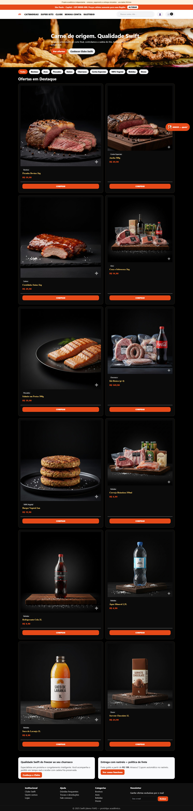
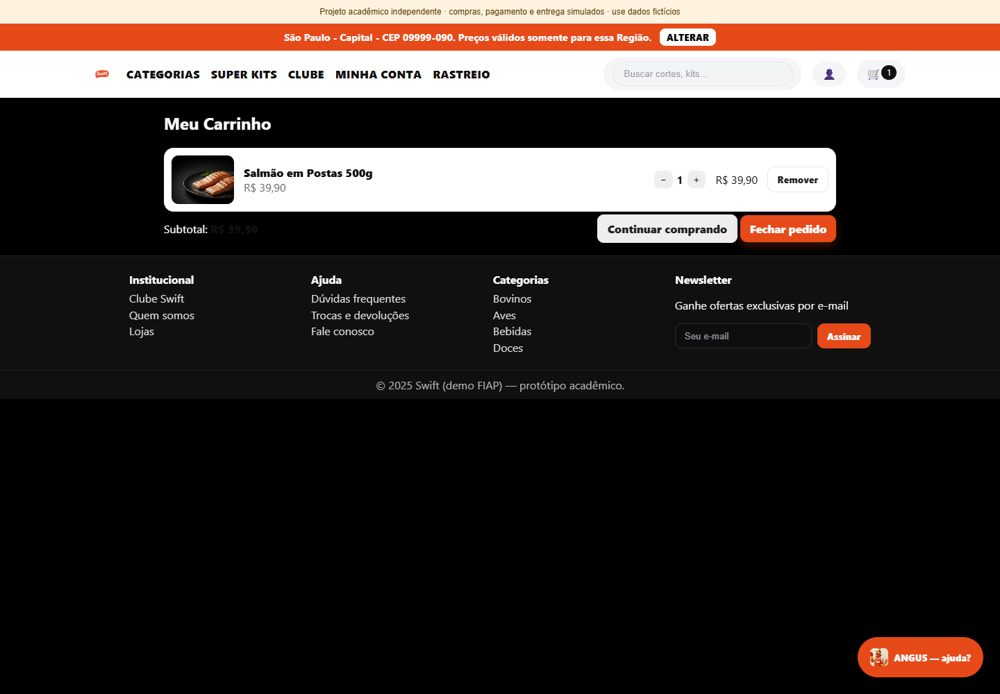
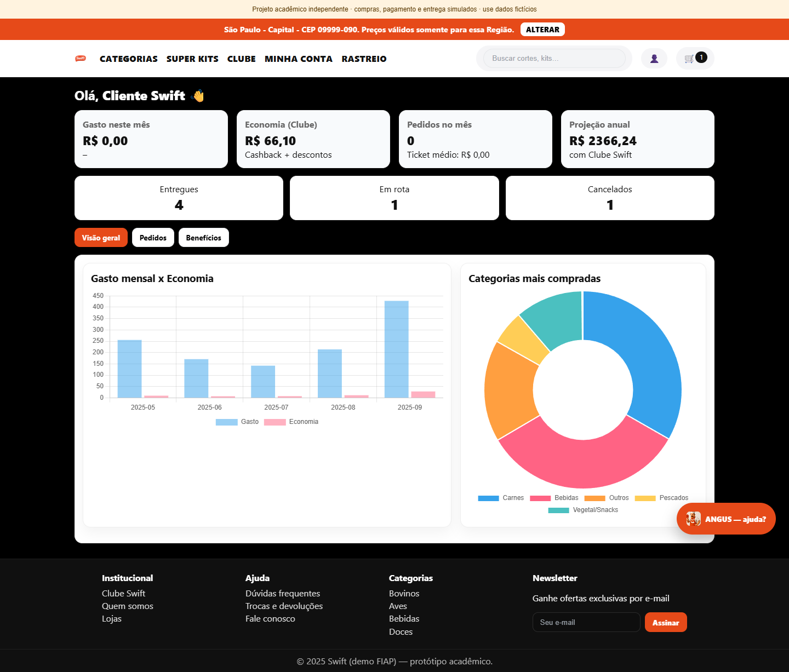

# Swift · Experiência digital de compra

Protótipo acadêmico de comércio eletrônico com catálogo, carrinho, clube de benefícios, painel do cliente e assistente guiado por regras. Explora como melhorar a experiência de compra e a apresentação de informações ao consumidor.

**Frontend em HTML, CSS e JavaScript · dados locais de demonstração**



## Tecnologias

| Tecnologia | Uso |
|---|---|
| HTML5 e CSS3 | Páginas, formulários, organização visual e layouts responsivos |
| JavaScript | Busca, filtros, carrinho e navegação interativa |
| LocalStorage | Persistência local do carrinho, clube e histórico demonstrativo |
| Chart.js | Gráficos do painel do cliente |
| Fetch API | Carregamento de cabeçalho e rodapé compartilhados |
| OpenStreetMap | Mapa incorporado de demonstração |
| Modelagem de dados | Proposta acadêmica do domínio de compras |

**Swift é a marca do desafio. O código não utiliza a linguagem Swift da Apple.**

## Recursos

- Catálogo com busca e filtros por categoria.
- Carrinho com atualização de totais e persistência no navegador.
- Clube de benefícios e cadastro demonstrativo.
- Dashboard com gráficos e exportação CSV de dados fictícios.
- Assistente Angus com respostas por palavras-chave e sugestões do catálogo.
- Percurso visual de entrega e pagamento.

O assistente é baseado em regras, sem modelo de IA generativa. Compras, pagamentos, rastreamento e benefícios são simulados. Não existe processamento de pagamento nem backend integrado ao modelo de dados.

## Demonstração visual





<details>
<summary>Visualização em celular</summary>


</details>

Todas as capturas foram obtidas executando os arquivos deste repositório no navegador. Conteúdo e indicadores são demonstrativos.

## Executar

Com Python 3 instalado, na raiz do projeto:

```powershell
python -m http.server 8000 --bind 127.0.0.1
```

Abra `http://127.0.0.1:8000`. Use um servidor HTTP; abrir o HTML diretamente como arquivo impede o carregamento dos componentes compartilhados por `fetch` em alguns navegadores.

Fontes, fotografias externas, Chart.js e o mapa usam serviços externos e precisam de internet. Imagens locais do catálogo estão em `css/IMAGES`.

## Estrutura

- `home.html`: catálogo e entrada principal.
- `carrinho.html` e `pagamento.html`: fluxo demonstrativo de compra.
- `cliente.html`: painel com indicadores e gráficos.
- `clube.html` e `clube-cadastro.html`: clube de benefícios.
- `partials`: cabeçalho e rodapé compartilhados.
- `script/script.js`: comportamento da interface e assistente por regras.
- `docs`: proposta acadêmica, modelo de dados original e capturas.

## Estado e validação

Busca por categoria, inclusão de produto e persistência no carrinho verificados no navegador. Não use dados pessoais ou financeiros reais: os formulários pertencem ao protótipo e parte dos dados fica no armazenamento local do navegador. O modelo de dados original é material de estudo e ainda precisa de revisão antes de servir de base a um backend.

## Contexto e autoria

Trabalho acadêmico FIAP, publicado no portfólio de Ericles Santos. A documentação de entrega preserva o contexto original e os créditos que acompanham o material. As marcas citadas identificam o desafio acadêmico; este repositório não é um produto oficial das empresas.

[Detalhes da validação](docs/validacao.md).
